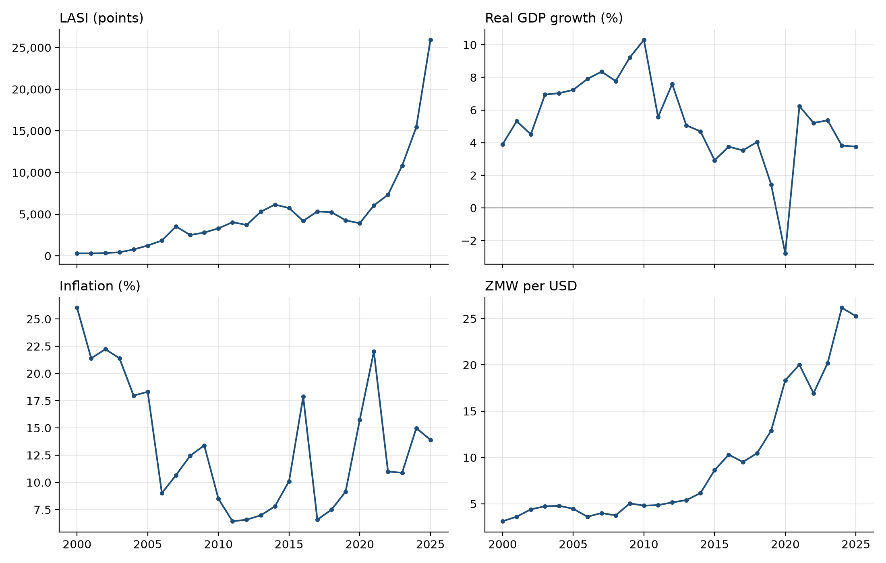
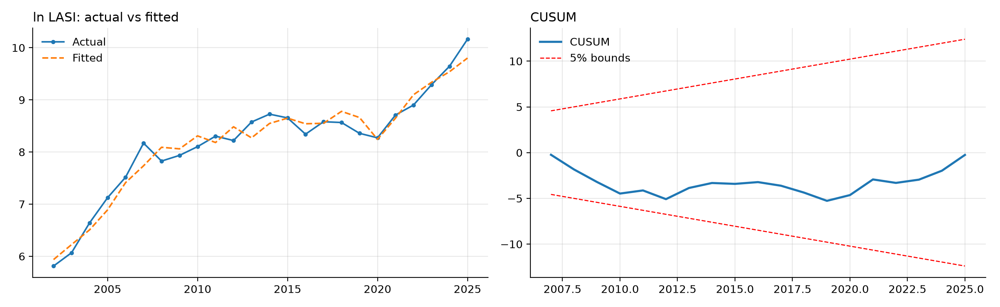

# Does the Macroeconomy Move the LuSE?

An ARDL analysis of how GDP growth, inflation and the Kwacha exchange rate relate to the Lusaka Securities Exchange All Share Index (LASI), Zambia, 2000 to 2025.

**Author:** Martin B. Mwaala, Qualified Accountant (ZICA) | MSc Financial Engineering | MBA Finance



## Key findings

| Hypothesis | Variable | Expected | Long-run result | p-value | Verdict |
|---|---|---|---|---|---|
| H1 | GDP growth | + | 0.233 | 0.044 | Supported |
| H2 | Inflation | - | -0.092 | 0.017 | Supported |
| H3 | Exchange rate (ln ZMW per USD) | - | 1.777 | 0.000 | Rejected: significant but positive |
| H4 | All three jointly | | F(3, 19) = 3.870 | 0.026 | Supported |

- **Growth lifts the market:** each extra percentage point of GDP growth goes with a LASI about 26% higher in the long run.
- **Inflation pulls it down:** each extra point of inflation goes with a LASI about 9% lower.
- **A weaker Kwacha goes with a higher LASI:** a 1% rise in ZMW per USD goes with a 1.78% rise in the index, the opposite of the expected sign.
- **The market corrects back to its long-run path:** the error correction term is -0.279 (p = 0.017), so about 28% of any gap closes each year, a half-life of about 2.1 years.
- **The model is strong and stable:** adjusted R-squared 0.947, all residual diagnostics pass and CUSUM stays inside the 5% bounds.

## Why it matters for finance

For investors, treasurers and FP&A teams with exposure to Zambian equities, the results quantify how the LuSE responds to the macro variables already in every budget and forecast: growth, inflation and the exchange rate. The finding that Kwacha depreciation goes with a higher LASI is worth testing directly in any scenario or stress analysis that assumes the opposite.

## Method

1. **Data:** GDP growth, inflation and the official exchange rate pulled live from the World Bank API (World Development Indicators, Zambia). LASI year-end closes from LuSE annual market reports, stored in `data/lasi_year_end.csv` with the source of each figure.
2. **Descriptive statistics and correlations:** levels and year-on-year changes, with variance inflation factors (highest VIF 1.46).
3. **Stationarity:** ADF and Phillips-Perron tests. LLASI and LEXR are I(1), GDPG and INFL are I(0), nothing is I(2), so ARDL bounds testing fits and Johansen does not.
4. **Lag selection:** every ARDL(p, q1, q2, q3) up to 2 lags compared on AIC. ARDL(1, 0, 0, 0) selected.
5. **Bounds test** (Pesaran, Shin and Smith, 2001, case III): F = 3.363, inconclusive at 5% and 10%.
6. **Long-run coefficients** with delta-method standard errors, and the error correction term.
7. **Diagnostics:** Breusch-Godfrey, Breusch-Pagan-Godfrey, Jarque-Bera, Ramsey RESET and CUSUM.
8. **Robustness:** rerun on 2000 to 2024 and 1997 to 2025. Signs and sizes hold on all three samples; without 2025 the bounds test confirms a long-run relationship at 10% (F = 4.091).



## Repository contents

| Path | What it is |
|---|---|
| `LuSE_ARDL_Analysis.ipynb` | Full analysis notebook, from data pull to conclusions |
| `data/lasi_year_end.csv` | LASI year-end closes, 1997 to 2025, with sources |
| `data/wdi_cache.csv` | Cached World Bank series (GDP growth, inflation, exchange rate) |
| `outputs/results.xlsx` | All result tables in one workbook |
| `outputs/*.png` | Trends, correlations, scatter plots, model fit and CUSUM charts |
| `requirements.txt` | Python packages needed to rerun the notebook |

## Run it yourself

```bash
python -m venv .venv
source .venv/bin/activate
pip install -r requirements.txt
jupyter notebook LuSE_ARDL_Analysis.ipynb
```

## Tools

Python (pandas, NumPy, SciPy, statsmodels, arch, matplotlib), Jupyter, World Bank API, Excel.

## Contact

Martin B. Mwaala, Lusaka, Zambia. Open to financial modelling, FP&A, data analytics and econometric analysis work. Connect on [LinkedIn](https://www.linkedin.com/in/martinbmwaala/).
